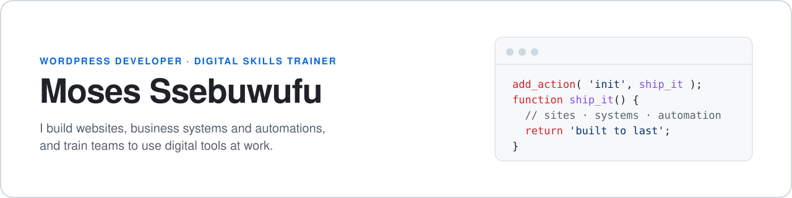
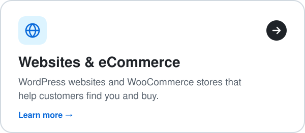
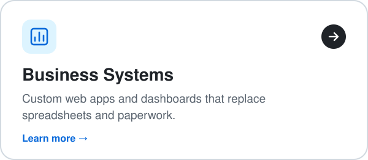
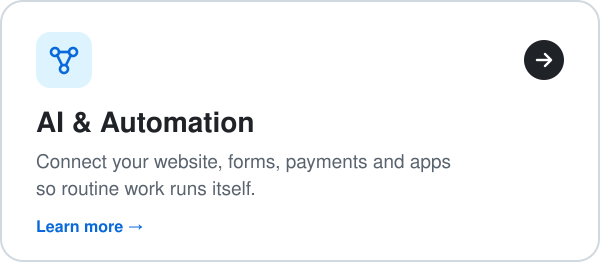
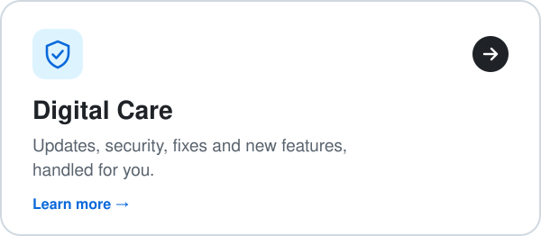
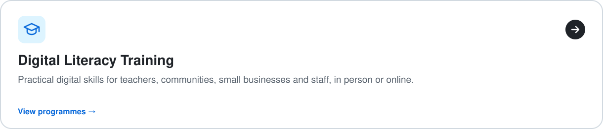

<a href="https://ssebuwufu.com"><picture><source media="(prefers-color-scheme: dark)" srcset="./assets/banner-dark.svg" /><source media="(prefers-color-scheme: light)" srcset="./assets/banner-light.svg" /></picture></a>

  
  
  
  

## Services

  <a href="https://ssebuwufu.com/services/websites-ecommerce/"><picture><source media="(prefers-color-scheme: dark)" srcset="./assets/service-web-dark.svg" /><source media="(prefers-color-scheme: light)" srcset="./assets/service-web-light.svg" /></picture></a>
  <a href="https://ssebuwufu.com/services/business-systems/"><picture><source media="(prefers-color-scheme: dark)" srcset="./assets/service-systems-dark.svg" /><source media="(prefers-color-scheme: light)" srcset="./assets/service-systems-light.svg" /></picture></a>
  <a href="https://ssebuwufu.com/services/automation-integrations/"><picture><source media="(prefers-color-scheme: dark)" srcset="./assets/service-auto-dark.svg" /><source media="(prefers-color-scheme: light)" srcset="./assets/service-auto-light.svg" /></picture></a>
  <a href="https://ssebuwufu.com/services/digital-care/"><picture><source media="(prefers-color-scheme: dark)" srcset="./assets/service-care-dark.svg" /><source media="(prefers-color-scheme: light)" srcset="./assets/service-care-light.svg" /></picture></a>
  <a href="https://ssebuwufu.com/digital-literacy/"><picture><source media="(prefers-color-scheme: dark)" srcset="./assets/service-train-dark.svg" /><source media="(prefers-color-scheme: light)" srcset="./assets/service-train-light.svg" /></picture></a>

## My technology stack

  <a href="https://ssebuwufu.com/services/"><picture><source media="(prefers-color-scheme: dark)" srcset="./assets/stack-dark.svg" /><source media="(prefers-color-scheme: light)" srcset="./assets/stack-light.svg" /></picture></a>

  <b>Have a project in mind?</b> &nbsp;<a href="https://ssebuwufu.com/contact/">Get in touch at ssebuwufu.com →</a>

